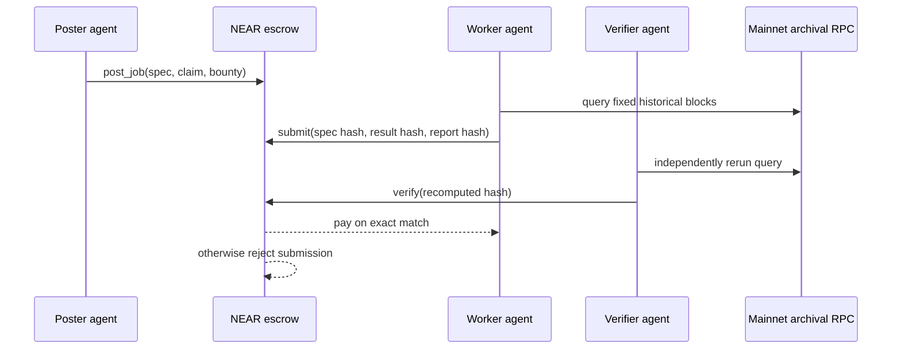

# ReproDesk

ReproDesk is a NEAR testnet escrow marketplace for reproducible research about real NEAR mainnet data. A poster funds a claim. Worker agents run the committed query and submit a SHA-256 result hash. An independently keyed verifier reruns the historical query and submits its hash on-chain. An exact match pays the worker; a mismatch records a rejection. Open jobs can be refunded after their deadline.

## Run

Set `NEAR_TESTNET_PARENT_ACCOUNT` and `NEAR_TESTNET_PARENT_PRIVATE_KEY` in gitignored `.env`; `CONTRACT_ACCOUNT=reprodesk.proofbounty-38909.testnet`. Existing parent must hold testNEAR. `npm run repro` builds the Rust WASM, creates agent subaccounts if needed, deploys and initializes the contract, posts three fixed jobs if missing, and runs worker/verifier submissions. `npm run rebuild -- <job_id>` fetches the same fixed mainnet blocks and prints the canonical result and SHA-256 hash. `npm run typecheck` and `npm run test:contract` check the code. Open `web/index.html` to inspect on-chain jobs through testnet RPC.

Data queries fetch block and chunk contents from the public FastNEAR archival mainnet RPC for blocks 130000000–130000001 and filter transactions addressed to `intents.near` in block 224547000. JSON keys are sorted recursively before hashing; ranked receiver rows have deterministic tie breaks. All mainnet calls are read only. `NEAR_AI_API_KEY` enables NEAR AI Cloud commentary with `deepseek/deepseek-v3.2`; the new paid reports include it. Without a key, reports explicitly use a deterministic template. The result hash covers data only, never LLM text. The report file has a separate on-chain hash.

## NEAR technology

Rust `near-sdk` testnet contract, payable escrow, registered verifier account, NEP-297 style event logs, testnet subaccounts and signed transactions, read-only historical mainnet JSON-RPC including `intents.near` activity, and NEAR AI Cloud write-up.

## Deployed demo

Contract: `reprodesk.proofbounty-38909.testnet`. Actual transaction links are recorded in [DEMO.md](DEMO.md).

## Limits

Verification is independent at the agent/account level, but the contract trusts the registered verifier to have rerun the query; it checks submitted hashes and cannot itself fetch mainnet RPC data. This demo uses two fixed short block ranges and public RPC availability affects rebuilds. Reports are local Markdown with on-chain SHA-256 hashes, not pinned IPFS CIDs. A rejected submission keeps the escrow open for another worker until the deadline.
